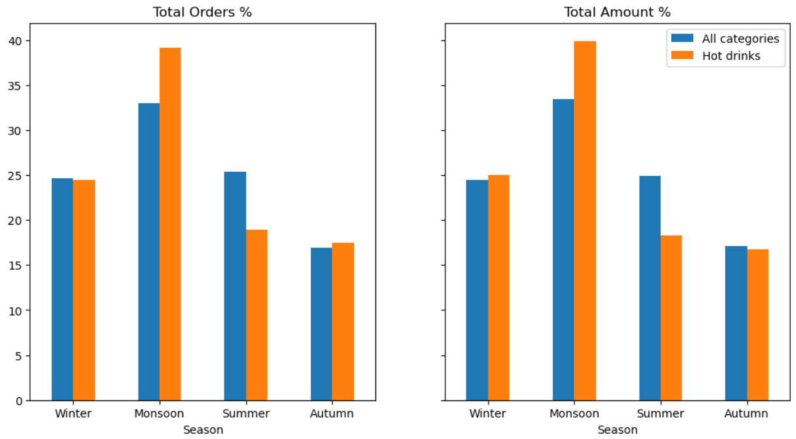

# 🥐 Python bakery analysis

This project was created to demonstrate my analytical skills and ability to use Python and its libraries for data analysis. During the project I cleaned the dataset, developed and tested several hypotheses, some of which were supported, while others were rejected. I also created drill-downs for each hypothesis. Ultimately, interesting patterns were identified that could help the bakery grow its customer base and increase profits.

## 🛠️ Tech Stack

* Python

* Pandas

* Matplotlib

* Seaborn

* Numpy

## 🔗 Source

Dataset was sourced from [Kaggle](https://www.kaggle.com/datasets/sdcloud/historical-bakery-sales-dataset?select=bakery_sales_dataset.csv).

## 📋 Project Workflow

* Data inspection

* Data cleaning and preprocessing

* Exploratory data analysis

* Sales analysis and visualization

* Key findings and conclusions

## 🔍 Key Findings

### 1. Seasonal Demand for Hot Drinks

**Hypothesis:** Demand for hot drinks peaks in winter due to lower temperatures.

**Finding:** Demand increase in winter but peaks in monsoon.

**Drill-down:**

- Compared the seasonal demand for hot drinks with overall product demand.

- Identified the products most frequently purchased alongside hot drinks.

Visualization 1 - Seasonal demand
<p align="center">
    
</p>


## 🚀 How to Run

1. Clone the repository:
    ```bash
    git clone https://github.com/kuzihr/python-bakery-analysis.git
    ```

2. Navigate to the project folder:
    ```bash
    cd python-bakery-analysis
    ```

3. Install dependencies:
    ```bash
    pip install -r requirements.txt
    ```

4. Open the Jupyter Notebook:
    ```bash
    jupyter notebook bakery_sales_analysis.ipynb
    ```
    or open it directly in Google Colab.
